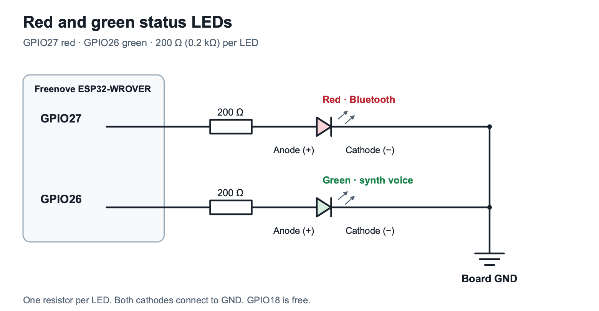

# Red and green status LEDs

Use two ordinary, low-current LEDs. Each needs its own **200 Ω (0.2 kΩ)**
series resistor. Connect each LED's anode (+) towards its GPIO and cathode (−)
to board GND. Identify the legs using the LED's datasheet; the cathode is commonly
the shorter leg beside the flat edge of the body.

| LED | Connection |
| --- | --- |
| Red | GPIO27 → 200 Ω → red anode; red cathode → GND |
| Green | GPIO26 → 200 Ω → green anode; green cathode → GND |



[Vector schematic (SVG)](status-leds.svg)

```text
GPIO27 ── 200 Ω ── red LED anode (+)    cathode (−) ── GND
GPIO26 ── 200 Ω ── green LED anode (+)  cathode (−) ── GND
```

Disconnect USB before wiring. Use GPIO labels rather than physical header
positions. Both LEDs share board GND, with separate resistors in their GPIO
paths. GPIO18 is free; the previous RGB LED is removed.

The synth button is GPIO25 to GND. Sensor Trig/Echo pairs are GPIO32/34 for
pitch and GPIO33/35 for volume.

## Red: Bluetooth connection

While disconnected, searching, connecting, or disconnecting, red blinks
**500 ms on, 500 ms off** (one full blink per second). It switches off immediately
when Bluetooth connects and starts a fresh blink, initially on, when disconnected.
Paused/stopped audio and hand movement do not change this connection indication.

## Green: synth voice

Green blinks continuously at the selected voice's rate, independently of Bluetooth
and whether sound is playing. Each blink spends equal time on and off.

| Synth | Blinks per second | On / off duration |
| --- | --- | --- |
| Sine | 0.5 | 1000 ms / 1000 ms |
| Triangle | 1 | 500 ms / 500 ms |
| Pulse | 2 | 250 ms / 250 ms |
| FM | approximately 3 | 167 ms / 167 ms |
| Organ | 4 | 125 ms / 125 ms |

Changing voice with the button or serial `synth` command starts the new green
blink with the LED on. It leaves red's timing alone. Bluetooth transitions leave
green's timing alone. During `showcase`, green follows the voice published by the
audio task, then returns to the selected voice when the showcase ends.

Both LEDs light during `setup()` before audio and Bluetooth initialize, without
needing a serial monitor. Their blinking advances once the main loop runs.

## Implementation and verification

[`StatusLeds`](../include/StatusLeds.h) owns the two pins and their independent
blink timers. It uses plain digital outputs and nonblocking `millis()` timing.
It handles delayed loop iterations and clock rollover, and writes only when an
output changes. It uses no PWM channels.

The constructor accepts red and green pins, defaulting to 27 and 26. `begin()`
configures both outputs off; the first `update(voice, connected)` lights the
appropriate indicators. Firmware calls it immediately during setup. `end()`
switches both LEDs off and releases the pins. Only the main task calls the class;
Bluetooth/audio callbacks continue to publish status without touching GPIO.

After uploading, confirm both LEDs light during startup, red blinks before the
speaker connects and switches off on connection, and green changes speed with
each button press. Switch the speaker off: red should resume blinking while
green keeps its current rate.

Native tests cover every rate, independent timing, Bluetooth transitions,
button/serial/showcase integration, boot visibility, initialization failures,
and continued audio/automatic theremin startup. Physical wiring needs checking
on the board.
